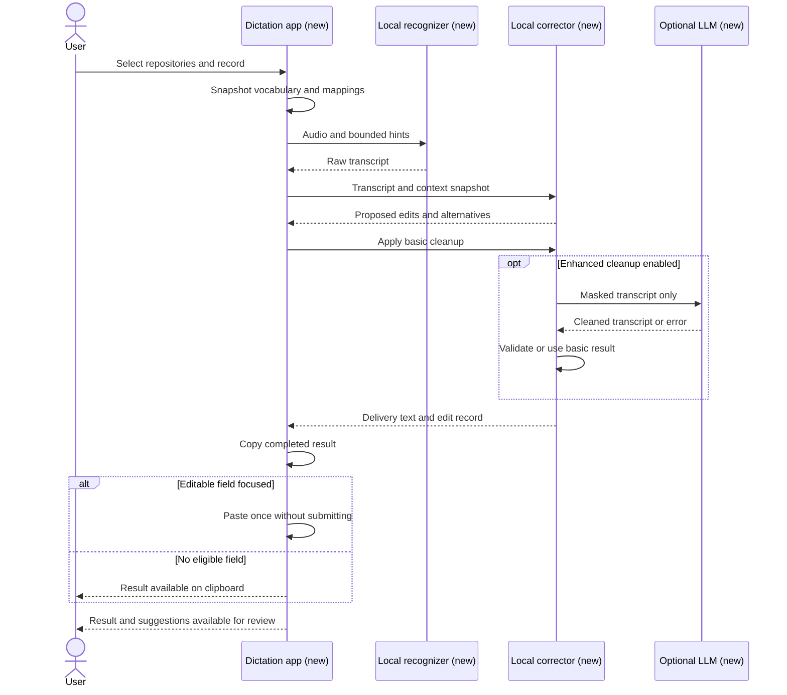

# Conch: repository-aware local dictation

## Summary

Build Conch, a cross-platform desktop dictation app for writing agent prompts. The user configures local repositories as vocabulary sources and defines phrase-to-text mappings. Audio transcription, repository correction, and basic filler cleanup run locally. Optional enhanced text cleanup prioritizes S1-mini running locally inside Conch, with configurable local endpoints and remote LLM APIs as alternatives. V1 uses a configurable global hotkey with push-to-talk or toggle recording. It automatically pastes the result into a focused text input when available and otherwise leaves it on the clipboard. Editor and agent integrations are outside scope.

The user authorized execution of this specification.
The local implementation and its remaining validation work are documented in `../validation/README.md`.
English is the initial recognition language.
`2026-11-11-languages-and-recognition-engines.md` adds recognition languages and a second recognizer engine, and supersedes this file's English-only and Whisper-only statements in the recognition sections.
`2026-11-12-profiles.md` moves the recognition language and model, Enhanced cleanup, Auto-accept, and the repository selection into profiles, and lets a recording switch profile while it runs.

## Requirements

- Require no paid service, account, API key, or subscription for core functionality. After an explicit model download, recording, indexing, transcription, repository correction, basic cleanup, and copying work offline. Enhanced cleanup is optional; remote providers may charge the user. The only other network request is the update check, which Settings can turn off.
- Let the user configure multiple repository roots and select which contribute context to a recording through the active profile. Keep the active profile visible on the Dictation page, in the menu bar menu, and on the recording indicator. Do not infer context from the foreground app.
- Support global mappings and repository-scoped mappings with an enable/disable control. A mapping replaces a spoken phrase or recurring transcription error with exact text, including case, punctuation, and path separators.
- Suggest corrections using indexed filenames, relative paths, and declared symbols. Preserve ordinary prose, negation, numbers, and instruction order outside approved edits.
- Always run Basic cleanup and offer optional Enhanced cleanup. Basic requires no LLM, and blank hesitation tokens make it a no-op. Enhanced is disabled by default. Its choices are an optional S1-mini download managed by Conch, a configured local endpoint, or a remote provider, endpoint, model, and API key.
- Preserve the raw transcript alongside the editable result. Show each proposed repository correction, its source repository/file, and competing candidates. Unresolved ambiguity remains unchanged until the user chooses.
- Let the user configure the global hotkey and choose push-to-talk (hold to record, release to finish) or toggle (press to start, press again to finish). Ignore key repeat. Cancellation must not copy or paste partial text.
- Automatically copy each successful nonempty result to the clipboard. Paste once if a text input is focused at delivery time; otherwise retain the result on the clipboard. Never submit the prompt or send an Enter keystroke.
- Provide recording controls, cancel, retry, copy, and visible errors. A failed correction must leave the raw transcript available. A failed recording or recognition must retain the prior result and allow retry or re-recording.

## Scope

- One local desktop app containing recording controls, a repository selector, mapping settings, index status, and transcript review. Recording uses the configured global shortcut and selected activation mode; delivery does not require confirmation.
- Read configured repositories without executing their code, hooks, build tools, or configuration scripts. Respect ignore rules, support extra exclusions, skip binary and generated content, and stay within configured roots. Do not follow symlinks outside a root.
- Index filenames and relative paths for eligible files. Initially extract declared symbols from Python, JavaScript, and TypeScript. Unsupported or unparseable files still contribute filenames; report skipped symbol extraction.
- Exclude auto-submit, editor plugins, agent integrations, screen/clipboard reading for context, spoken code generation, automatic correction learning, and general-purpose LLM prompt rewriting. Cleanup edits the transcript; it must not answer the dictated request, expand it, or invent requirements.

## Approach

Use an existing local speech recognizer behind a replaceable interface. Use Tauri 2 with a TypeScript/React interface and a Rust application core. Evaluate whisper.cpp for recognition and llama.cpp for S1-mini through recorded-prompt experiments before pinning inference builds. Keep recognition hints optional because engines may support them differently. The correction stage must also work on a raw transcript without recognizer hints.

The diagram shows how a recording uses a fixed context snapshot and produces a reviewable result. All app participants are new. The optional LLM endpoint is external to the app and may run locally or remotely.

### Technology and platform support

Target macOS, Windows, and Linux desktop builds with a shared Rust core and TypeScript/React UI in [Tauri 2](https://v2.tauri.app/start/). Use Tree-sitter grammars for repository symbols and SQLite for local indexes/mappings. Use Rust audio capture and file watching, with exact crates selected during implementation. Use platform credential storage for optional API keys.

Evaluate [whisper.cpp](https://github.com/ggml-org/whisper.cpp) for shared local recognition and llama.cpp for S1-mini. Bundle inference workers with the app; users do not install Python, model servers, or development tools. Prefer separate inference workers with cancellable local IPC so native inference failures do not terminate the UI. Verify packaging, memory use, and hardware acceleration on each target before pinning builds.

Keep hotkey registration, focused-field detection, clipboard access, paste simulation, permissions, and credential storage behind platform adapters. Shared logic owns recording mode, context snapshots, mappings, cleanup, and delivery decisions. Tauri's [global-shortcut plugin](https://v2.tauri.app/plugin/global-shortcut/) is the initial hotkey candidate. A generic input simulation library does not establish that a text input is focused.

Test macOS and Windows full delivery behavior. Linux support must identify the tested desktop/session: X11 and Wayland are separate validation targets. Where a desktop cannot supply global shortcuts or reliable text-field detection, expose the unsupported capability and provide in-app recording plus clipboard output. Do not claim automatic-paste parity without an end-to-end test. The exact release platform matrix remains to be established by the delivery experiment.

Confidence: moderate for the proposed stack; target-specific recognition performance and delivery compatibility are unknown. SwiftUI/WhisperKit are superseded as application-wide choices because the user requires broader desktop support.

### Vocabulary and indexing

Persist repository configuration and mappings locally. Build a read-only vocabulary index with source locations. Refresh changed files in the background and offer manual refresh. Removing a repository removes its indexed vocabulary and disables its mappings. A missing root is marked unavailable and excluded from new recordings.

Snapshot the active profile's vocabulary and mappings when recording starts. A profile switch during the recording replaces the snapshot and recognizes the audio heard so far again. Background updates affect subsequent recordings. Show index freshness, term count, and incomplete/error status, and let users browse, search, and filter a repository's indexed terms in pages. Large repositories must not block recording; use the last completed snapshot or explicitly proceed without repository vocabulary. File-size, index-size, and recognizer-hint limits are implementation decisions to measure in the experiment. The recognition hint lists enabled mapping replacements first, then multi-word and acronym identifiers that more files declare, up to 400 bytes. It is sent to the local recognizer only and never to a remote cleanup endpoint. The recognizer sometimes answers a pause with the hint itself, as a comma-separated list of its terms in the middle of a dictation. Conch drops a recognized sentence that is a comma-separated list with at least two hint terms, in hint order and ignoring case, and at most one other item, because the recognizer can misspell one term ("C2" for "C#"). That item has no more words than the longest hint term. A dictated sentence of that form is dropped too. A mapping replacement or identifier that contains a comma is left out of the hint, because the hint's terms are read back by splitting at commas.

### Correction rules

- Apply explicit mappings using case-insensitive whole-phrase matching, with longest matches first. Preserve replacement text exactly. Apply mappings once to original spans; never recursively remap replacement output.
- A selected repository's mapping overrides a global mapping for the same phrase. Conflicting replacements across selected repositories require a user choice. Do not silently choose by repository order.
- Rank remaining candidate edits by spoken-word similarity and evidence in the selected repositories. Use identifier tokenization so a phrase can match camelCase or snake_case. Match sound-alikes of multi-word identifiers: letters of an all-uppercase word may be spelled by name ("pod gee see" for `podGC`), and a multi-word identifier of eight or more letters tolerates a small edit distance when the heard run has as many words as the identifier ("max group" for `maxGroups`, but not "appear" for `AppBar`). A single-word term must match exactly. Repository candidates are suggestions requiring acceptance by default; recognizer confidence alone cannot authorize a replacement. The user can opt into Auto-accept in a profile (off by default), which applies each suggestion whose candidates share one spelling, with no mapping conflict and no overlapping suggestion, as an accepted edit before delivery, so Undo restores the heard words. It never saves a mapping. Accepting a suggestion may also save an explicit mapping from the heard phrase to the candidate, scoped to the candidate's repository. Only the user's action creates that mapping.
- Protect mapping output and exact identifier/path matches from further correction. Do not apply broad substring replacements. Allow the user to reject suggestions, edit manually, or copy the raw transcript.

Explicit mappings give predictable output for recurring terms. Repository suggestions handle unfamiliar identifiers without requiring the user to maintain an alias for each one. Enhanced cleanup is a separate optional stage and cannot authorize repository suggestions.

### Transcript cleanup

Cleanup changes output text. Cutting filler sounds out of recorded audio, audio enhancement, and exporting edited recordings are outside scope.

- With no hesitation tokens, Basic preserves the recognizer output after explicit mappings. A recognizer may already omit disfluencies; Conch does not promise verbatim audio transcription.
- Basic uses deterministic rules to remove standalone hesitation tokens from a small editable list, initially `um` and `uh`, and repairs adjacent whitespace and punctuation. Preserve quoted text (a single quote opens after a non-word character and closes before one, so contraction apostrophes never form a quote), mapped output, exact indexed identifiers/paths, and explicitly excluded terms. Leave uncertain literal uses unchanged. Do not automatically remove `like`, `so`, `well`, or `you know`, collapse repeated words, or resolve self-corrections.
- Enhanced adds punctuation/capitalization repair, contextual filler removal, repeated-fragment cleanup, and spoken self-corrections. Use the selected model's required input format. Preserve technical terms, constraints, negation, numbers, and ordering of instructions. Do not summarize or execute the request. Keep the before/after diff available in the result view.

Apply mappings and mark protected spans before cleanup. Enhanced cleanup receives placeholders for protected spans; require each placeholder exactly once in its original order and restore its exact original text. Reject malformed output, missing/reordered placeholders, empty output for meaningful input, and detected changes to protected literals or constraints. These checks cannot prove semantic equivalence. Flag detected ambiguity for review and deliver the Basic result instead of the questionable rewrite.

Snapshot cleanup settings with the recording context. Wait for the configured cleanup stage before the single clipboard/paste operation. On timeout, network/authentication failure, invalid output, or unavailable local endpoint, use the Basic result with a visible status. Do not retry or paste a later response automatically. Cancel must discard any late response. If Basic removes all content, show that nothing remains and leave the clipboard unchanged.

Remote cleanup is disabled by default. Before enabling it, show the destination and explain that dictated text will leave the device and that the provider may charge for requests. Send only the masked transcript and fixed cleanup instruction; do not send audio, repository files, vocabulary indexes, source locations, or clipboard contents. The transcript itself may contain confidential information even after masking. Keep credentials in the platform credential store (Keychain on macOS), exclude them from exports/logs, and allow removing them. Use HTTPS for remote endpoints; allow plain HTTP only for loopback local endpoints. Do not fall back from a local endpoint to a remote service.

### S1-mini evaluation and integration

S1-mini is the preferred local Enhanced cleanup candidate. Conch manages its download and runtime so users do not need a separate model server or API key. Keep Enhanced disabled until the user chooses it. Confirm integration through the acceptance corpus before treating model selection as final. Validate both CPU execution and the acceleration path selected for each supported platform.

The [model card](https://huggingface.co/superwhisper/s1-mini) documents English-only support, a 462 MiB quantized build, GGUF runtime support, and a recommended input limit of roughly 1,000 tokens. It requires its exact system prompt/control-line format, thinking disabled, and greedy decoding. Start with semi-formal/prose/general controls; compare changes to technical prompts. Confidence: high for these documented requirements; Conch latency and accuracy are unknown.

Evaluate GGUF execution on the target hardware, protected-placeholder preservation, filler-only empty results, and long prompts. Pin the selected revision and checksum. For inputs over the evaluated limit, fall back to Basic with visible status in v1; do not silently truncate or split across spoken corrections. Download size does not establish runtime memory requirements.

Retain the published [LICENSE](https://huggingface.co/superwhisper/s1-mini/blob/main/LICENSE) and [NOTICE](https://huggingface.co/superwhisper/s1-mini/blob/main/NOTICE), and preserve the model attribution "S1-mini" by "Superwhisper" in model settings and acknowledgments. The published license includes an additional naming condition. Confidence: high for the published condition.

### Recording and delivery

Check hotkey availability when saving settings and report conflicts. Show recording and processing status without taking focus from the receiving app. Reject another recording while processing in v1. Cancel stops the current operation and leaves the previous clipboard and result unchanged.

Use the platform focused-field adapter (Accessibility on macOS, UI Automation on Windows, and a tested desktop-specific mechanism on Linux) to check whether the focused element accepts text immediately before delivery. Do not inspect its contents for repository context. Paste replaces the current selection or inserts at the caret using the receiving app's normal paste behavior. Do not activate another app or restore an earlier focus target. If focus changes during the delivery check, skip paste and retain the clipboard result. Secure/password fields are ineligible.

The Dictation page exposes the required recognition-model download and microphone/automatic-paste permission controls during setup. While Automatic paste is off, setup omits the paste permission.
Settings captures a pressed shortcut combination instead of requiring shortcut syntax.
Settings has an Automatic paste switch, on by default. Off copies each result and never requests a paste.
Settings has a Microphone menu. System default follows the input the system uses. A chosen device is saved by name, and Conch uses the system input when that device is not connected.
A small nonactivating recording indicator floats above other applications. It shows the recording level and duration, a drawing spiral while processing. It carries no label while recording or processing and disappears after a paste. It shows text only for a clipboard fallback, an empty result, or an error.
The indicator must not change the receiving app or its focused input, and users can disable it.
Request the permissions needed for microphone capture, the global shortcut, and focused-field detection at setup. If detection permission is missing, the field is unsupported, or editability is uncertain, use clipboard-only delivery and explain why. Do not issue a blind paste or automatically retry a failed paste; retain the clipboard result for manual use. Actual insertion success may be unknown in some apps.

Automatic delivery uses the transcript after unambiguous explicit mappings and the configured cleanup stage. Leave conflicting mapping spans and unaccepted repository suggestions unchanged; with Auto-accept on, suggestions that qualify are already accepted edits in the delivered text. Review remains available afterward without blocking delivery. Accepting a suggestion or editing a delivered result updates the in-app result only; the user can copy the revision explicitly. Never paste a revision automatically.

### Recognition timing and background operation

Recognition overlaps recording. The recognizer worker starts when recording starts, and the managed cleanup worker starts then when Enhanced cleanup uses it. Audio is cut into chunks at pauses (at least one second of quiet after 8 seconds of audio, or the quietest point once 25 seconds are pending) and each chunk is recognized while recording continues. Only the tail remains after the stop. If any chunk fails, Conch recognizes the whole recording once. Recognizer segment breaks become single spaces because dictated prose has no line breaks.

Settings offers three English recognition models: Tiny (`tiny.en`), Base (`base.en`), and Small (`small.en`, the default for a new install). Settings saved before the choice existed keep Tiny, the only model those copies can have installed. Each is pinned by revision and SHA-256 and downloaded on request. The recognizer runs with Silero voice detection (`whisper-server --vad`), so a chunk that contains only silence or noise returns no text. Without it the vocabulary hint made `tiny.en` answer silence with "you" or "Thank you.", and larger models answered with longer phrases. Every recognition model download includes the voice detection model, and recording requires both files. Changing the model stops idle recognizers; the next recording starts the new one. The Dictation setup checklist and Settings use one menu that shows Installed in place of the size for a model on disk, and the selected model shows Installed, a download button that names it, or a progress bar beside the menu. The checklist saves a pick at once; Settings keeps it in the unsaved draft. Settings has no separate list of models, and the S1-mini download and status sit under Enhanced cleanup.

Workers stay running between recordings and stop after 10 minutes (recognizer) or 5 minutes (managed cleanup) without use, on cancellation of the recording that used them, and on exit. Conch stops workers left by a crashed earlier run at startup.

Closing the main window hides it and keeps Conch running behind a menu bar icon that shows recording and processing state and the installed version. If the icon cannot be created, closing the window quits the app.

### Storage and recovery

Store settings and indexes in the app's local data directory. Hold recording audio in memory and discard it after success or cancellation; bound recording duration and show the limit. Do not persist audio. Do not persist transcript history unless the user turns on Keep history in Settings, which is off by default. With Keep history on, save each delivered nonempty result with its raw transcript and delivery time in the local database, keep the newest 500, and keep the saved text in step with later review edits. The History page lists entries newest first with search, copy (result or raw transcript, never paste), delete, and a confirmed Clear history. Turning Keep history off keeps existing entries until the user deletes them. Preserve the latest result in memory until replaced or the app closes. Write a diagnostic log, `conch.log`, to the data directory whether or not Keep history is on: one JSON object per line with a Unix time, a level (info, warn, error), a source, a message, and optional details. It rolls over at 2 MB to one previous file, `conch.log.1`, and so holds about 4 MB. It must omit audio, transcripts, source text, and full private paths: the home directory is written as `~`, every other absolute path (Unix, Windows, UNC, `file://`, or quoted with spaces) is reduced to `.../file name`, and a message is cut at 2,000 characters and details at 8,000. Log stage times, delivery outcomes and clipboard-fallback reasons, recognition and cleanup failures, worker starts, stops with the reason, and failures (with the recognizer's last 20 stderr lines that begin with a library prefix (`ggml_`, `whisper_init`, `whisper_model_load`, `whisper_backend`, `whisper_vad`, `error:`, and a few others), each cut at 300 characters, only when it fails to start or exits unexpectedly; the cleanup worker's output is never kept, because workers can print the text they process), errors the interface showed for a failed command (source `ui`, cut at 500 characters, a repeat within a minute and any beyond 20 a minute dropped), downloads, update checks, permission changes, and index size changes. The Logs page lists entries newest first, 50 at a time, with a level filter (All, Warnings, Errors), a source filter, search over message, details, and source, Copy shown entries (text with UTC times), Show log file, and a confirmed Clear logs. The status line under the result carries no timing; the Dictation page links it and its error banner to Logs.

### Updates

Publish releases on GitHub. A tag `vX.Y.Z` triggers a workflow that builds installers for macOS, Windows, and Linux, signs each updater artifact with the updater key, and attaches them and `latest.json` to a draft release. Installed copies see a release after it is published.

Conch checks `https://github.com/greerviau/conch/releases/latest/download/latest.json` shortly after launch and then every 24 hours, retrying within an hour after a failure. Settings has a switch for the automatic check, and a manual check is always available from Settings and the menu bar icon. The request carries no transcript, audio, setting, or identifier.

Never install without the user choosing to. Installing is refused while a recording or result is in progress. After the new version is on disk, Conch waits for any recording to finish, stops its workers, and restarts.

The updater verifies each artifact against the public key in `tauri.conf.json`, so a build from this source accepts official releases without holding the private key. Forks replace the public key and endpoint. A self-built Linux binary outside an AppImage cannot self-update.

Sign every macOS release with the same certificate, because the Accessibility grant is keyed to it. The release workflow fails when the built app does not match the stable designated requirement. Notarization needs a Developer ID identity and is not part of this decision; moving to one revokes each existing grant once.

## Work items

1. Evaluate local recognition, rule-based cleanup, and optional model-assisted cleanup, starting with S1-mini, with user-supplied prompt recordings; deliver a selected runtime, measured latency/error results, resource limits, and model license/download requirements.
2. Add repository configuration, vocabulary indexing, and explicit mappings; prove exclusions, source attribution, refresh, removal, and conflict handling. Depends on item 1.
3. Add the local recording/transcription flow and context snapshots; prove offline operation, cancellation, bounded resource use, and recovery. Depends on item 2.
4. Add Basic cleanup, managed local S1-mini execution, and optional endpoint configuration, credential storage, validation, and fallback; prove protected text survives and remote processing stays opt-in. Depends on item 3.
5. Add correction review, configurable hotkey modes, focused-field detection, automatic paste, and clipboard fallback; prove exact mappings, reversible suggestions, and complete delivery behavior. Depends on item 4.
6. Package reproducible macOS, Windows, and Linux builds and installation instructions; verify the acceptance corpus and fresh-install model setup. Depends on item 5.

## Testing strategy

- Build a user-approved corpus containing recurring aliases, negation, spoken corrections, filenames, symbols, similar identifiers across repositories, and ordinary prose resembling code. Include unseen identifiers to measure vocabulary benefit.
- Compare raw recognition with corrected output on identical recordings. Report identifier errors fixed, incorrect substitutions introduced, edits required, stop-to-result latency, and peak memory on the target hardware. Set performance thresholds after establishing the hardware and baseline.
- Require exact expected output for mapping fixtures, no changes to protected spans, deterministic conflict handling, and no unsolicited repository replacements while Auto-accept is off. Verify that rejecting suggestions restores the affected raw spans without losing manual edits elsewhere.
- Test filler deletion and punctuation repair alongside quoted fillers, identifiers containing filler tokens, legitimate repetition, negation, numeric constraints, and spoken corrections. Compare Basic and Enhanced against user-approved expected outputs.
- Test local and remote cleanup configuration, credential removal/redaction, request payloads, placeholder corruption, timeouts, cancellation, late responses, and invalid/empty rewrites. Require Basic fallback without duplicate insertion. With remote cleanup disabled, require zero cleanup network requests.
- Test repository isolation, ignored files, external symlinks, malformed files, unavailable roots, interrupted refreshes, and context selection changes during recording. No vocabulary from unselected repositories may enter the current context. Run the shared correction/indexing tests on macOS, Windows, and Linux.
- Verify that the log rolls over at its limit, that a damaged line is skipped, that the home directory appears as `~`, that no transcript or result text reaches it (including through worker output), that the Logs page filters, searches, pages, copies, and clears, and that a worker that fails to start leaves its last output in the log.
- Test both hotkey modes, key repeat, conflicts, cancellation, permission denial, and recording while processing. With networking disabled after model setup, verify automatic paste into eligible fields, selection replacement, clipboard fallback, focus changes, unsupported and secure fields, and paste failures. Require at most one paste per result, no submission, no automatic paste after review edits, and no persisted audio/history by default. With Keep history on, verify that each delivered result appears once on the History page, that review edits update its text, that delete and Clear history remove entries, and that the oldest entry goes at 501. Empty or failed transcription must leave the clipboard unchanged.

## Risks and open questions

- Target desktop platforms: macOS, Windows, and Linux. English dictation remains the initial language assumption. Hotkey configuration, push-to-talk/toggle modes, automatic paste, and clipboard fallback are user requirements.
- Initial symbol languages are proposed. Confirm against the repositories the user wants to configure.
- Recognition quality, vocabulary-hint effectiveness, latency, and memory requirements on the target hardware are unknown. Item 1 resolves these before inference builds and hardware requirements are finalized; it requires representative recordings and hardware details.
- Focused-field detection and paste behavior need an experiment across representative text inputs on each target platform, including T3 where available. Unsupported fields fall back to the clipboard; application-specific integrations remain outside scope.
- File and symbol candidates can collide across repositories. V1 requires user resolution and does not claim active-file or semantic code awareness.
- Enhanced cleanup can alter meaning despite its instructions and validation. Its quality and acceptable latency are unknown until evaluated on the prompt corpus.
- S1-mini is the first local model to evaluate. Protected placeholders and already formatted identifiers may differ from its training inputs; acceptance tests must establish preservation before automatic delivery uses it.
- Model and parser dependencies remain unselected. Check their licenses, supported hardware, offline behavior, and redistribution requirements during item 1. This spec makes no dependency-specific performance claims.
