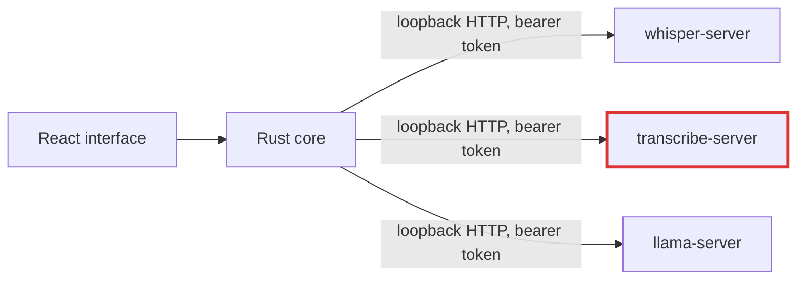
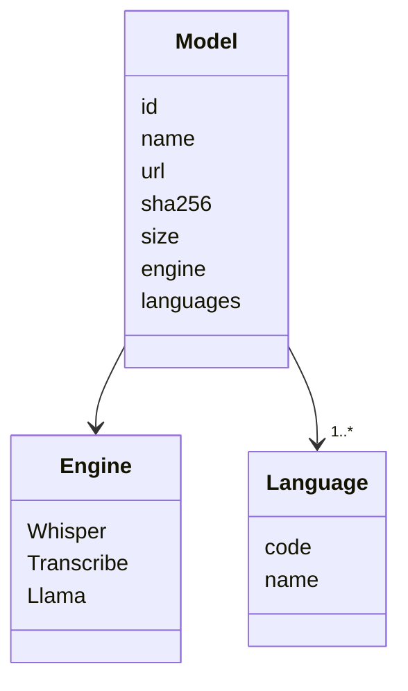
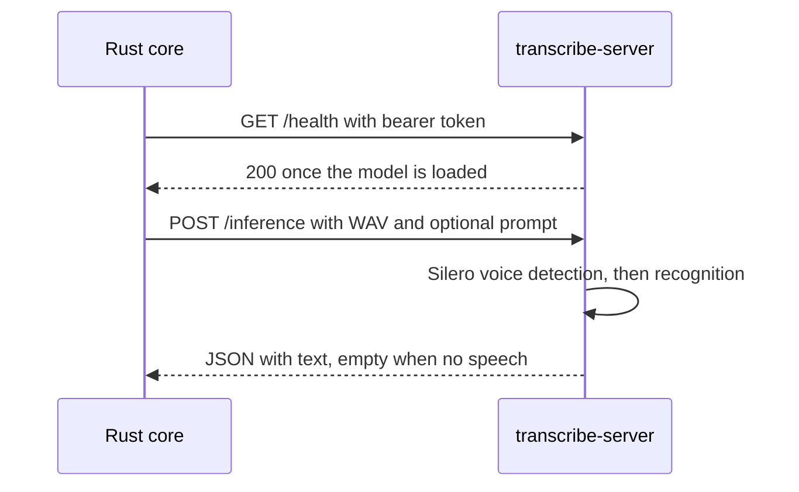
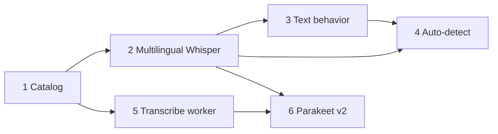

# Recognition languages and engines

## Summary

Conch recognizes English only, with Whisper `.en` models. This change adds two things.

- A recognition language setting: an explicit menu of every language Whisper supports, plus Auto-detect. English stays the default.
- A second recognizer engine, built on [transcribe.cpp](https://github.com/handy-computer/transcribe.cpp), that runs NVIDIA Parakeet TDT v2 (English). Whisper keeps its own worker.

Both changes reshape one table. A recognition model declares its engine and the languages it supports, and the language choice filters the model menu. Rust owns that table and the interface reads it from the app state.

This spec supersedes the English-only and Whisper-only statements in `2026-11-09-conch.md` (Requirements, Recognition timing and background operation). That file keeps the rest of the design.

## Requirements

- Settings has a Language menu. It lists Auto-detect, then English, then every other language in the pinned whisper.cpp language table (100 entries including English), sorted by name. New installs use English. Settings saved before the field existed load as English.
- The Recognition model menu lists only models that support the chosen language. Auto-detect lists only models that support more than one language.
- A recording uses the language and model chosen when it starts, as part of the context snapshot.
- Whisper models offered: the existing `tiny.en`, `base.en`, `small.en`, plus multilingual Tiny, Base, Small, and Large Turbo (q5_0). Parakeet TDT v2 (Q8_0) is offered for English.
- Core dictation still works offline after a model download. Each new model is pinned by revision and SHA-256 and downloaded on request, as the current models are.
- Each behavior that depends on language has a defined result for English, for every other language, and for Auto-detect (see Approach). Features Conch cannot support for a language are off with a visible reason in Settings.
- The interface stays in English. Translating it is out of scope.
- Parakeet ships with its LICENSE and NOTICE files and its attribution ("Parakeet" by NVIDIA, CC-BY-4.0) in model settings and acknowledgments, as S1-mini does.
- A native failure in the new worker must not terminate the app. The new worker is a separate process like the existing ones.

Out of scope: interface translation, per-language filler lists Conch cannot test, per-language letter-name tables, Parakeet v3, replacing `whisper-server` with transcribe.cpp, mixed-language accuracy guarantees, and Windows or Linux acceptance of the new worker beyond a build that succeeds.

## Scope

All changes sit in the one app. The new component is a worker process.

Touched areas: `inference.rs` (catalog, launch, request), `storage.rs` (settings, migration), `core.rs` (snapshot, cleanup, mapping comparison), `spoken.rs` (letter names, case folding), `app.rs` (view, validation, recording flow), `src/` (models, Settings, Setup), `scripts/build-runtimes.py`, a new worker source, `src-tauri/licenses`, `docs/`.

## Approach

### Model catalog

`Model` gains `engine` and `languages`. The catalog moves to a single source in Rust, and `view` returns each model's id, label, note, size, engine, and languages. `src/models.ts` stops holding model data.

- `languages` is a list of codes from one shared table. `.en` models and Parakeet v2 list only `en`. Multilingual Whisper models list all 100 entries.
- A model supports `auto` when it lists more than one language.
- `missing()` keeps adding the Silero model for every recognizer. The VAD model is shared by both engines.

Model rows to add. Sizes and SHA-256 come from the file listing of `ggerganov/whisper.cpp` at the revision `inference.rs` already pins (`5359861c...`) and of `handy-computer/parakeet-tdt-0.6b-v2-gguf` at `58239cf6d0ecb0af921e7936c1e5e0a8dba91dbb`.

| Id | File | Bytes | SHA-256 |
|---|---|---|---|
| `tiny` | `ggml-tiny.bin` | 77691713 | `be07e048e1e599ad46341c8d2a135645097a538221678b7acdd1b1919c6e1b21` |
| `base` | `ggml-base.bin` | 147951465 | `60ed5bc3dd14eea856493d334349b405782ddcaf0028d4b5df4088345fba2efe` |
| `small` | `ggml-small.bin` | 487601967 | `1be3a9b2063867b937e64e2ec7483364a79917e157fa98c5d94b5c1fffea987b` |
| `large-v3-turbo` | `ggml-large-v3-turbo-q5_0.bin` | 574041195 | `394221709cd5ad1f40c46e6031ca61bce88931e6e088c188294c6d5a55ffa7e2` |
| `parakeet-tdt-0.6b-v2` | `parakeet-tdt-0.6b-v2-Q8_0.gguf` | 729574912 | `f0d0e99cebb6d3b83f1f7069b82b5d3c2e39a54545b0da039cb4bafd9c4e5caa` |

The existing `.en` rows are unchanged; their listed sizes and hashes match this listing. Parakeet Q4_K_M (475491840 bytes, `4853f965...`) is measured in the prototype and offered only if its accuracy is within the measurement noise of Q8_0.

### Language setting

- `Settings.language` holds an ISO code from the shared table or `auto`. The snapshot captures it.
- `storage::load` resets an unknown code to `en`. If the saved model does not support the saved language, load keeps the language and selects the smallest model that supports it; if none is installed, recording reports the missing download.
- `choices_valid` rejects a language the model does not support, and `auto` for a single-language model.
- In Settings, changing the language in the draft keeps the current model if it supports the language, and otherwise selects `small` (or `small.en` for English). The Dictation checklist menu follows the same rule.
- Whisper receives the language in each `/inference` request through the `language` form field, and the launch flag `--language en` is removed. `auto` is sent as `auto`, which whisper.cpp treats as detection. The pinned `whisper-server` reads `language` per request (`examples/server/server.cpp`, verified at the revision `build-runtimes.py` pins), so changing the language does not restart pooled workers.
- Parakeet v2 supports English only, so it receives no language field.

### Language-dependent behavior

| Behavior | English | Other language | Auto-detect |
|---|---|---|---|
| Hesitation tokens | `um`, `uh` by default | Empty by default, editable per language | None removed; Settings shows why |
| Spelled-letter matching of acronyms (`pod gee see`) | On | Off | Off |
| Managed S1-mini cleanup | Available | Falls back to Basic with a visible status | Falls back to Basic with a visible status |
| Local or remote cleanup endpoint | Available | Available | Available |
| Mapping and identifier matching | Unicode case folding | Unicode case folding | Unicode case folding |

- `Cleanup.fillers` becomes a map from language code to token list. A saved list loads as the English list, because a type change would otherwise fail `storage::load` with "Settings are invalid". The Hesitation tokens row edits the list for the selected language.
- A shared default list would delete real words in some languages ("um" is a Portuguese article and a German preposition), so no list is shared.
- `spoken.rs` takes its letter-name table from the language. Only English has one. The camelCase split uses Unicode case checks and `to_lowercase` comparisons replace `eq_ignore_ascii_case` in `core.rs` and `spoken.rs`.
- The recognition hint stays an identifier list in any language. Whether it biases Whisper toward English output in Auto-detect is measured (see Risks).

### Parakeet worker

transcribe.cpp is a C/C++ library with a CLI and no server, so Conch builds a small `transcribe-server` that exposes the same loopback protocol as the patched `whisper-server`.

- Arguments and environment match `whisper-server`: `--host`, `--port`, `--model`, `--vad-model`, `--threads`, `--no-gpu`, and `CONCH_WORKER_TOKEN`. The server rejects requests without the bearer token, answers only `/health` and `/inference`, and caps the payload at 8 MiB.
- transcribe.cpp allows one `transcribe_run` in flight per model, so the worker serializes requests. Conch already sends chunks in order.
- The worker runs the Silero model from `ggml-silero-v5.1.2.bin`, so a chunk with no speech returns empty text. The transcribe.cpp README lists Silero VAD v6.2.0 and its header notes 16 kHz v5.1.2 `.bin` weights; the prototype confirms that file loads.
- `inference.rs` adds `Kind::Transcribe`. It shares `WHISPER_IDLE`, the pool, leases, cancellation, and `shutdown`. `reap_orphans` adds the new binary name. The pool key already includes the executable path, so engines never share a worker.
- `build-runtimes.py` pins transcribe.cpp at tag `v0.4.2`, commit `275cd50d2c4104c204009a197ac091b9687668e5`, and copies its MIT license next to the binary. The worker's HTTP layer reuses cpp-httplib, as `whisper-server` does.
- A capability flag on the engine says whether the recognition hint is sent. The prototype sets it. If Parakeet takes no vocabulary or prompt input, the hint is not sent, the Recognition model note says so, and repository correction runs on the raw transcript as the original spec requires.

### Decisions and rejected options

- **Engine: transcribe.cpp.** It builds with CMake like the other workers, covers Parakeet and Whisper and other families through one API, and uses the ggml backends. Rejected: sherpa-onnx. It has no server, needs ONNX Runtime and its own worker anyway, and does not share ggml acceleration.
- **Separate worker process.** Rejected: linking transcribe.cpp into the Tauri process. A native inference crash would end the app, which the original spec's worker isolation requirement forbids.
- **Whisper stays on `whisper-server`.** Rejected: moving Whisper to transcribe.cpp now. It would remove the patched server, but it changes a working path and mixes two risks. It is a follow-up once the new worker has shipped.
- **One shared language table.** Rejected: a curated subset (the user chose the full list) and per-model hand-written lists.
- **Explicit language with Auto-detect added last.** Auto-detect runs per chunk, and the tail after the last pause can be one or two seconds long. If measurement shows language flips, the first chunk's detected language is reused for the rest of the recording. That change belongs to the Auto-detect work item.
- **Parakeet v2 only.** Rejected for now: v3. It covers 25 European languages with automatic detection, and its model card does not say whether a language can be forced. It is a later catalog row.

## Work items

Each item lands in one PR. Tests are written first and the failing run recorded.

1. **Catalog in Rust.** Add `engine` and `languages` to `Model`, the shared language table, and the model metadata in `view`; remove model data from `src/models.ts`. Behavior is unchanged. Done when catalog invariant tests pass and the interface menus render from `view`.
2. **Multilingual Whisper and the language setting.** Add the four multilingual rows, `Settings.language`, snapshot capture, validation and load fallback, the per-request `language` field, and the Language menu that filters the model menu. Remove `--language en`. Auto-detect is not offered yet. Done when a recording in a chosen language sends that code and Settings round-trips. Depends on 1.
3. **Language-dependent text behavior.** Per-language hesitation tokens with the migration, English-only letter names, Unicode case folding, and the managed S1-mini fallback with its status. Done when the behavior table's tests pass. Depends on 2.
4. **Auto-detect.** Add the `auto` option, offered for multilingual models. Measure language flips on short tails, and reuse the first chunk's language if they occur. Done when the measurement is recorded in `docs/validation/` and the option ships with the measured behavior. Depends on 2 and 3.
5. **Transcribe worker.** Prototype first: confirm the C API takes in-memory audio (or fall back to a temporary WAV), loads the Silero `.bin`, and reports whether Parakeet accepts a vocabulary or prompt. Then add `transcribe-server`, `Kind::Transcribe`, the build pin, and orphan reaping. Done when the worker passes the fake-server tests and a real-worker acceptance test. Depends on 1.
6. **Parakeet v2.** Add the catalog row, the engine routing in `transcribe` and `preload`, the hint capability, the license and attribution, and docs. Done when a recording with Parakeet delivers text and the latency record lists Parakeet beside `small.en`. Depends on 2 and 5.

Items 3 and 5 can proceed in parallel after their dependencies.

## Testing strategy

- Catalog: unique ids, 64-character hashes, pinned (not `main`) revisions, nonempty `languages`, 100 unique language codes, `auto` valid only for models with more than one language.
- Settings: legacy settings load as English; an unknown code resets; a model that does not support the language is replaced; a saved filler list loads as the English list.
- Fake worker (Unix): the request carries the `language` field; the launch has no `--language`; changing language reuses the same process; the Parakeet fake receives no language field.
- Behavior table, one test per cell: Portuguese or German text keeps "um" with tokens empty; mapping and identifier matching fold non-ASCII case; letter names produce no suggestion outside English; managed cleanup reports Basic fallback for non-English and Auto.
- Interface (Vitest): the Language menu filters the model menu; picking a language the model lacks switches the model; Auto-detect disables the Hesitation tokens row and shows the reason.
- Acceptance (`#[ignore]`, real workers): a silence-only chunk returns empty text for every engine, and Parakeet and Whisper deliver text for an English WAV. For other languages, speech generated with macOS `say` voices tests recognition plumbing and rough error rate. It does not test accents or code-switching, and the validation record says so.
- Measurement: `examples/latency.rs` records stop-to-text latency and peak memory for `small.en`, multilingual `small`, `large-v3-turbo`, and Parakeet Q8_0 (and Q4_K_M) on the development Mac. Record only what runs. Windows and Linux remain untested beyond a successful build, and the validation record separates them from the tested macOS behavior.
- Existing suites (`npm test`, `npm run lint`, `npm run check`, `cargo fmt`, `cargo clippy`, `cargo test`) pass at every item.

## Risks and open questions

- transcribe.cpp is at 0.4.2 and its header says the ABI may break between 0.x minor releases (confidence: high, from the header). It tagged `v0.3.1`, `v0.4.0`, `v0.4.1` between 2026-10-04 and 2026-10-22 and `v0.4.2` on 2026-11-11. Pin the commit and upgrade deliberately.
- I read only part of `transcribe.h`. The load, run, and in-memory input signatures are unconfirmed, which is why work item 5 starts with a prototype (confidence: low until then).
- Parakeet vocabulary or prompt support is unknown. A summary of the header names `vocabulary` and `prompt` options gated by per-model features (confidence: low). Without it, Parakeet loses the recognition hint that Whisper uses for repository identifiers.
- Parakeet's behavior on silence-only chunks is unchecked. The worker returns empty text for chunks the Silero model marks as no speech.
- Multilingual Whisper models hallucinate on silence more than `.en` models, and the existing voice detection mitigates it (confidence: moderate; the tiny `.en` case is documented in the original spec). The English identifier hint may bias Auto-detect output toward English (confidence: low). Both are measured in item 4.
- Mixed speech, such as prose in one language with English identifiers, is the likely common use and is the hardest case. Accuracy is unknown and may be poor. Item 4 reports it for the synthetic samples only.
- Multilingual accuracy depends on the language. Whisper's published per-language error rates vary widely, and Conch makes no per-language accuracy claim.
- Disk and memory: `large-v3-turbo` (q5_0) is 574 MB and Parakeet Q8_0 is 730 MB on disk. Runtime memory is unmeasured. Download size does not establish it.
- Model licensing: Parakeet is CC-BY-4.0 (Hugging Face model card metadata) and needs attribution. transcribe.cpp is MIT (repository LICENSE). The Whisper weights license is unchecked in this spec and is confirmed during item 2 when the multilingual files are added.
- Assumptions recorded without a user answer: Parakeet v2 only in this release; Q8_0 as the offered quantization; Auto-detect shipped last; no per-language filler lists beyond English.
- External sources: whisper.cpp `examples/server/server.cpp` and `src/whisper.cpp` at the pinned revision (per-request `language`, `auto` detection, 100-entry `g_lang`); [Hugging Face file listing for ggerganov/whisper.cpp](https://huggingface.co/ggerganov/whisper.cpp) at revision `5359861c`; [Parakeet v2 GGUF](https://huggingface.co/handy-computer/parakeet-tdt-0.6b-v2-gguf) and [v3 GGUF](https://huggingface.co/handy-computer/parakeet-tdt-0.6b-v3-gguf) model cards; the [transcribe.cpp README](https://github.com/handy-computer/transcribe.cpp) and `include/transcribe.h`.
